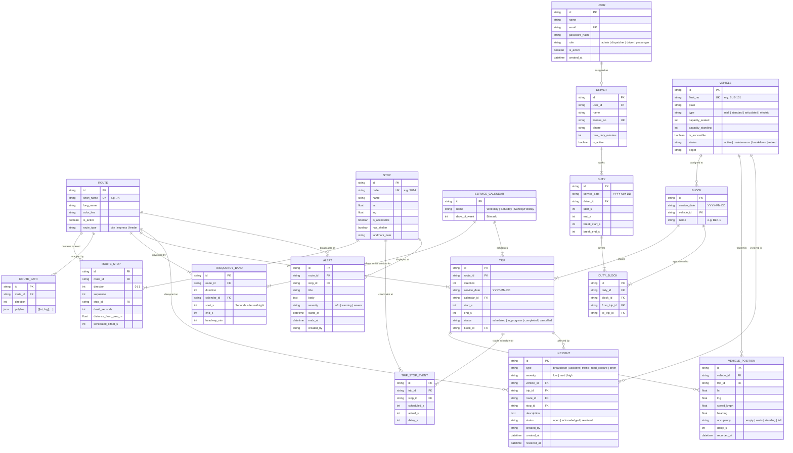

# Wayline System Entity-Relationship (ER) Diagram

This document models the complete relational domain schema for **Wayline** (Public Transport Fleet Scheduling & Passenger Information System), based on `SPEC.md §4` and implemented via SQLAlchemy 2.0.

---

## 1. High-Level Entity Relationship Diagram

---

## 2. Key Domain Groups

### A. Network Topology
- **`Stop`**: Physical pickup/dropoff points with GPS coordinates, shelter availability, and accessibility features.
- **`Route`**: Transit line definitions with branding color hex and mode classifications.
- **`RouteStop`**: Ordered junction table determining travel sequences, dwell periods, and timetable offsets per direction.
- **`RoutePath`**: Serialized polyline path for map rendering and simulator interpolation.

### B. Timetable & Scheduling
- **`ServiceCalendar`**: Service schedules per day category (Weekdays, Saturdays, Holidays).
- **`FrequencyBand`**: Base headway rules defining trip emission rates throughout operational time bands.
- **`Trip`**: Concrete scheduled runs between start and end terminals.
- **`Block`**: Consecutive chains of trips covered by a single assigned vehicle.
- **`Duty` & `DutyBlock`**: Legal shift packaging assigned to individual drivers conforming to max duty hours and mandatory break rules.

### C. Fleet & Real-Time Telemetry
- **`Vehicle`**: Bus inventory, capacities, depot allocations, and maintenance/breakdown states.
- **`Driver`**: Licensed transit operators with duty constraints.
- **`VehiclePosition`**: Real-time telemetry point updates (speed, coordinates, heading, delay, occupancy).
- **`TripStopEvent`**: Historical and live arrival tracking powering on-time performance analytics.

### D. Operations & Passenger Information
- **`Incident`**: Breakdowns, accidents, or disruptions with automated replacement candidate ranking.
- **`Alert`**: Public-facing advisories visible directly on stop boards and route banners.
